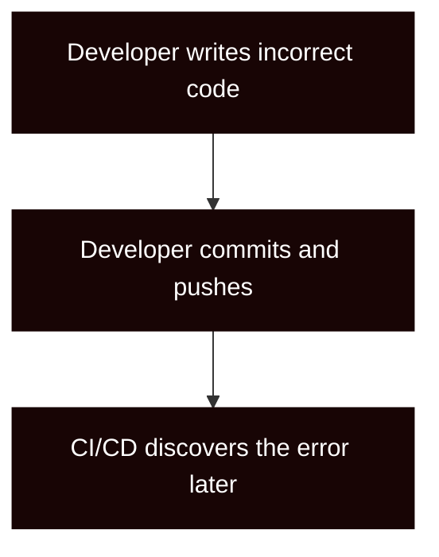
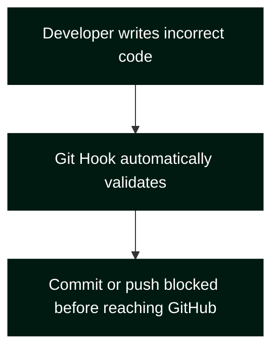

# 1. What exactly is a Git Hook?

A Git Hook is a script that executes automatically when a particular Git event occurs. Think about a software development company.
A developer writes code and wants to commit it. 

Before allowing the commit, the company wants to check:
- 1 Is the code valid?
- 2 Are unit tests passing?
- 3 Are there coding standard violations?
- 4 Is the commit message correct?

Instead of asking developers to remember all these checks, Git Hooks automate them.

Real-world example:

Imagine a developer writes:

```python
def calculate_total(price, tax):
    return price + tax
```

The developer accidentally introduces a bug:

```python
def calculate_total(price, tax):
    return price + unknown_variable
```

A Git Hook can automatically execute a validation script and prevent the developer from committing this code.

##### Without Git Hooks



##### With Git Hooks



##### Key Benefits
- **Early Detection:** Identify errors before pushing code.
- **Code Quality:** Automatically validate coding standards.
- **Security:** Detect potential vulnerabilities early.
- **Reduced Failures:** Prevent avoidable CI/CD pipeline failures.
- **Developer Productivity:** Provide immediate feedback.

